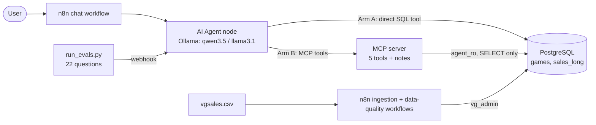

# Regional Game Market Analyst

A portfolio project: an n8n chat agent answers plain-English questions about
regional video game sales (vgsales, 16,598 rows), and an evaluation suite
measures how accurate it is. The main experiment tests whether a small set of
narrow MCP tools beats letting the model write its own SQL.
Details: [PHASE5_MCP_RESULTS.md](PHASE5_MCP_RESULTS.md).

## Architecture



## Results

**Setup:** frozen question set (22 questions: 13 dev, 9 heldout), scorer v8,
temperature 0.1, context 4096. Accuracy is *answer* accuracy only. Baselines
were originally graded with scorer v7 and re-graded with v8
(`evals\results\rescored\`). The dev questions were used to tune prompts, so
**heldout is the fair column**.

**Prompt versions** (full text in `prompts/`):
- **v1:** the starting prompt, before failure-driven rules were added. (The llama v1 result file is named `v1b`; this is only a filename quirk.)
- **v2:** v1 plus rules written from failures on Q01-Q13: use the right columns, never join the two tables, rank games by summing per title, fix SQL errors and retry, refuse to modify data.
- **v2b:** v2 plus an explicit percentage rule with a worked example for each direction (denominator = the region's sales, or the genre's sales) and a ranking line (GROUP BY the column being ranked). 441 words vs 387.

| Model | Setup | DB role | Runs/question | Overall | Dev | Heldout |
|---|---|---|---|---|---|---|
| qwen3.5:4b | Prompt v1, direct SQL | agent_ro | 3 | 55/66 = 83.3% | 32/39 = 82.1% | 23/27 = 85.2% |
| qwen3.5:4b | Prompt v2, direct SQL | agent_ro | 3 | 62/66 = 93.9% | 38/39 = 97.4% | 24/27 = 88.9% |
| qwen3.5:4b | Prompt v2b, direct SQL | agent_ro | 6 | 126/132 = 95.5% | 78/78 = 100% | 48/54 = 88.9% |
| qwen3.5:4b | v2b + MCP | vg_admin | 3 | 64/66 = 97.0% | 39/39 = 100% | 25/27 = 92.6% |
| qwen3.5:4b | v2b + MCP (re-run) | agent_ro | 3 | 65/66 = 98.5% | 39/39 = 100% | 26/27 = 96.3% |
| llama3.1:8b | Prompt v1, direct SQL | agent_ro | 3 | 33/66 = 50.0% | 20/39 = 51.3% | 13/27 = 48.1% |
| llama3.1:8b | Prompt v2, direct SQL | agent_ro | 3 | 44/66 = 66.7% | 26/39 = 66.7% | 18/27 = 66.7% |
| llama3.1:8b | Prompt v2b, direct SQL | agent_ro | 6 | 113/132 = 85.6% | 77/78 = 98.7% | 36/54 = 66.7% |
| llama3.1:8b | v2b + MCP | vg_admin | 3 | 59/66 = 89.4% | 36/39 = 92.3% | 23/27 = 85.2% |
| llama3.1:8b | v2b + MCP (re-run) | agent_ro | 3 | 59/66 = 89.4% (58/66 after hand-check, see Q17) | 36/39 = 92.3% | 23/27 (22/27 after hand-check) |

**Headline:** MCP did not measurably change accuracy. Differences are within
noise (Fisher exact, Phase 5 runs: qwen p ≈ 0.72; llama p ≈ 0.51 overall, 0.11
heldout), and p-values are indicative only because outputs are near-deterministic.
Re-running the same MCP arm under a different DB role moved scores by 0 (llama)
and 1.5 points (qwen), which is a rough floor for run-to-run variation.

**Prompt tuning did not generalize.** For llama, dev went 66.7% → 98.7% from
v2 to v2b while heldout stayed at 66.7%. For qwen, heldout stayed at 88.9%
while dev rose to 100%. The prompt rules were written from dev failures, so
dev scores are partly circular.

### Where it mattered (per question)

| Question | Failure mode | Model | Direct SQL → MCP |
|---|---|---|---|
| Q14 | "Other" treated as a country | llama | 0/6 → 3/3 (all MCP runs) |
| Q22 | Gave a forecast | llama | 0/6 → 2/3 |
| Q17 | Partial-2016 / year totals | llama | 0/6 → 0/3 in substance: every MCP answer swapped the years and reported an "increase" |
| Q17 | same | qwen | Genuine pass with MCP: 2015 = 264.44, 2016 = 70.93, a decrease |
| Q12 | "How many games" (rows vs titles) | llama | 6/6 → 0/3 in all three MCP runs (stable regression) |

- The Q14/Q22 gains fit the **caveats attached to every tool response** better
  than narrow tools themselves. No ablation was run.
- 41% (qwen) and 50% (llama) of Phase 5 MCP runs still used model-written SQL
  (`run_readonly_query`).

### Limitations
- Small samples (22 questions); baseline has 6 runs per question, MCP has 3.
- The frozen scorer checks that both numbers appear, not which year each belongs
  to, so a Q17 "pass" can hide a wrong answer. Llama's `agent_ro` re-run scored
  Q17 1/3, but all three answers were wrong.
- The frozen prompt still mentions a `query_vgsales` tool that does not exist
  in the MCP arm (kept so only the tool set differs).
- Method (SQL) scores are not comparable for MCP and are not reported.
- Result files do not record the prompt version; prompt text is kept in `prompts/`.
- Dataset is historical and effectively ends in 2016.
- **Known issue:** a first llama `agent_ro` run (`..._182724`, 92.4%) had 28
  rows with exact figures but no logged tool call, and a false Q17 pass. It was
  discarded and re-run. A by-hand test and the re-run behaved normally. The
  cause is unexplained; the files are kept as evidence.

## Security

The agent can read data and nothing else. The strongest layers are enforced by
the database, not by code that parses text. These layers describe the
`agent_ro` configuration, which the direct-SQL arm used throughout. The Phase 5
MCP runs used `vg_admin`; the server was then switched to `agent_ro` and re-run
with the same accuracy.

| Layer (strongest first) | What it does |
|---|---|
| `agent_ro` role | SELECT only on `games` and `sales_long`. Tested: `DELETE` returns "permission denied for table games", even with the read-only flag switched off. |
| Read-only transaction | `default_transaction_read_only=on` on every connection. |
| Statement timeout | 5 seconds per query. |
| Row cap | At most 50 rows returned. |
| Narrow tools | `genre_share`, `compare_regions`, `top_games` use fixed SQL, whitelisted column names and bound parameters. |
| Keyword blocklist | Fallback `run_readonly_query` only. The weakest layer; blocklists can be bypassed. |

**Evidence that prompts are not a security control:** llama attempted
`DELETE FROM games` through the direct-SQL tool in 3/3 runs under prompt v1,
0/3 under v2 and 3/3 under v2b, with the refusal rule unchanged. The tool
connects as `agent_ro`, which rejected every attempt, and the table was never
modified (16,598 rows after each run). In the MCP runs, no write-like
statements appeared in the logged SQL.

**Test finding:** the blocklist wrongly rejected `LIKE 'Call of Duty%'` because
of "call" inside a string. No-LLM tests caught it; the fix strips quoted text
before the keyword check.

### Known risks (not fixed)
- **No authentication on the MCP server.** Bound to 127.0.0.1 only. Do not expose it.
- **Fallback tool accepts arbitrary SELECTs**, bounded by grants, timeout and row cap, not an allow-list.
- **Prompt injection.** Tool output reaches the model. Low exposure here (no free text beyond game and publisher names).
- **Call log holds model-written SQL.** `mcp_server\tool_calls*.jsonl` is git-ignored.
- **Credentials** live in `.env` (git-ignored) and n8n's credential store.

## Project layout

- `sql\01_schema.sql`, `sql\02_readonly_role.sql`: table, view and read-only role.
- `sql\data_quality_checks.sql`, `sql\digest_queries.sql`: used by the data-quality and digest workflows.
- `mcp_server\`: the MCP server. `prompts\`: system prompts. `workflows\`: exported n8n workflows.
- `evals\`: question set, runner and results. `tool_usage.py`, `compare_arms.py`: analysis scripts.

## How to run (Windows PowerShell)

**Prerequisites:** Windows, Docker Desktop, Python 3.12, [Ollama](https://ollama.com).

1. `Copy-Item .env.example .env`, then set real passwords and an encryption key.
2. Put `vgsales.csv` in `.\data\` (check the dataset's licence before publishing it).
3. `docker compose up -d` (n8n on http://localhost:5678, Postgres on 127.0.0.1:5432).
4. Create the schema and the read-only role:
   ```powershell
   Get-Content sql\01_schema.sql | docker compose exec -T postgres psql -U vg_admin -d vgsales -f -
   $pw = Read-Host "agent_ro password"
   Get-Content sql\02_readonly_role.sql | docker compose exec -T postgres psql -U vg_admin -d vgsales -v "agent_pw=$pw" -f -
   ```
5. In n8n, import the workflows from `workflows\`, add the Postgres credentials, run ingestion, then the data-quality workflow.
6. `ollama pull qwen3.5:4b` and `ollama pull llama3.1:8b`. From n8n in Docker, Ollama is at `http://host.docker.internal:11434`.
7. Start the MCP server (leave running):
   ```powershell
   cd mcp_server
   python -m venv .venv
   .\.venv\Scripts\pip install -r requirements.txt
   # mcp_server\.env: PGHOST, PGPORT, PGDATABASE, PGUSER=agent_ro, PGPASSWORD
   .\.venv\Scripts\python.exe server.py streamable-http
   ```
8. Run the evals from the repo root (needs `pip install requests`):
   ```powershell
   python evals\run_evals.py --label qwen3.5-4b_v2b_mcp_agent_ro --runs 3 --url http://localhost:5678/webhook/eval-agent-mcp --expect-model qwen3.5
   python tool_usage.py evals\results\<run>.json mcp_server\tool_calls.jsonl
   python compare_arms.py --base <baseline files> --mcp <run>.json
   ```